# MediTrack database ER diagram

The diagram below reflects `schema.sql` plus additive tables in migrations `001_operational_modules.sql`, `002_notifications.sql`, and `003_inventory_reconciliation.sql`. Apply any unapplied migration only with approval.

```mermaid
erDiagram
    roles ||--o{ users : assigns
    pharmacies o|--o{ users : scopes
    pharmacies ||--o{ suppliers : serves
    pharmacies ||--o{ medicine_batches : owns
    medicines ||--o{ medicine_identifiers : identifies
    medicines ||--o{ medicine_batches : catalogues
    suppliers o|--o{ medicine_batches : supplies
    pharmacies ||--o{ inventory : balances
    medicine_batches ||--o| inventory : stocked_as
    pharmacies ||--o{ sales : records
    users ||--o{ sales : cashier
    sales ||--|{ sale_items : contains
    medicine_batches ||--o{ sale_items : fulfills
    pharmacies ||--o{ scan_history : scopes
    users o|--o{ scan_history : scans
    medicines o|--o{ scan_history : matches
    medicine_identifiers o|--o{ scan_history : identifier
    pharmacies ||--o{ expiry_alerts : tracks
    medicine_batches ||--o{ expiry_alerts : alerts
    users o|--o{ expiry_alerts : acknowledges
    pharmacies ||--o{ stock_transfers : source
    pharmacies ||--o{ stock_transfers : destination
    medicine_batches ||--o{ stock_transfers : leaves_from
    users ||--o{ stock_transfers : requests
    users o|--o{ stock_transfers : approves
    users o|--o{ stock_transfers : receives
    pharmacies ||--o{ stock_history : scopes
    medicine_batches ||--o{ stock_history : movement
    stock_transfers o|--o{ stock_history : explains
    users o|--o{ stock_history : records
    pharmacies ||--o{ inventory_reconciliation_sessions : reconciles
    users ||--o{ inventory_reconciliation_sessions : starts
    users o|--o{ inventory_reconciliation_sessions : reviews
    inventory_reconciliation_sessions ||--|{ inventory_reconciliation_items : counts
    inventory ||--o{ inventory_reconciliation_items : snapshot
    pharmacies ||--o{ storage_logs : monitors
    medicine_batches o|--o{ storage_logs : concerns
    users o|--o{ storage_logs : records
    storage_logs ||--o| storage_condition_details : condition
    pharmacies ||--o| storage_policies : configures
    users o|--o{ storage_policies : updates
    pharmacies ||--o{ recall_records : scopes
    medicines ||--o{ recall_records : affects
    medicine_batches o|--o{ recall_records : batch_scope
    users o|--o{ recall_records : creates
    pharmacies ||--o{ forecast_results : forecasts_for
    medicines ||--o{ forecast_results : predicts
    forecast_results ||--o| forecast_explanations : explains
    pharmacies o|--o{ audit_logs : scopes
    users o|--o{ audit_logs : actor
    pharmacies ||--o{ notifications : receives
```

`stock_transfers.batch_id` refers to the source pharmacy lot. At receipt, MediTrack creates or matches the corresponding destination lot and records that destination lot in `stock_history` with the transfer ID. No destination batch column is added to the existing transfer table.

Notifications reference the owning pharmacy and use an idempotent unique event key. Their polymorphic entity reference intentionally has no foreign key because notification types target batches, transfers, and storage log rows.

Reconciliation item rows reference the session and inventory using pharmacy-composite foreign keys. They preserve the system count snapshot and latest stock-history ID for stale detection; the generated discrepancy is not copied into or used to rewrite historical inventory data.
